# Agartha: the Frozen Heaven (Minecraft Bedrock add-on)

Agartha is the heaven of your world: a vast floating Hyperborean realm of snow, ice, quartz and gold above a sea of clouds. It's laid out after Mercator's map of the far north. A frozen lake at the centre holds **the Pole**, and four ways lead out from it. There is exactly **one way in, the Heavenly Gate, and one way out**.

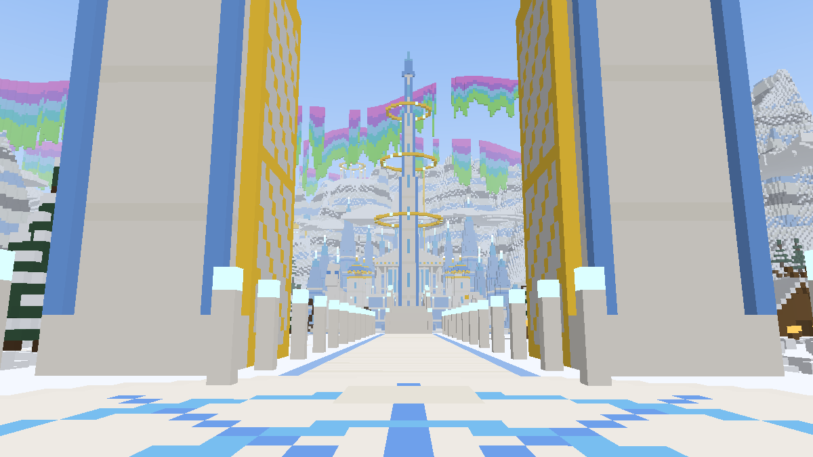

## 1. Forging Agartha (do this first, in person)
1. As an operator, run **`/scriptevent agartha:forge`**.
2. You're switched to spectator mode and **carried over the build site** while Agartha is built. Your presence is what loads the far-away chunks, and it's why forging is reliable now. Stay in the game; progress shows in the action bar and chat.
3. When it's done, you're returned to where you started, in your original game mode, and you receive the **Keystone of the Heavenly Gate**.

Progress is saved. If forging is interrupted (you log off, the game closes) or some sections can't load, run `/scriptevent agartha:forge` again and it continues where it stopped.

## 2. Raising the Heavenly Gate (the one entrance)
Either way works:
- **Keystone:** tap the ground with it, or use it while looking at the ground. A quartz-and-ice archway with open golden gates rises there, facing you, with a glowing portal inside.
- **By hand:** take *Heavenly Gate of Agartha* portal blocks from the **Agartha** creative group and build your own frame. The first portal block you place founds the Gate; more blocks within 12 of it become part of it.

**Walk into the glowing portal surface, or tap it**, to arrive at the Gates of Agartha.

- There is **only one Gate**. Portal blocks placed anywhere else are removed, and you're told where the Gate stands.
- If the Gate is torn down completely, its **Keystone returns** to whoever broke the last of it, so the Gate can be raised again somewhere else. `/scriptevent agartha:gate_reset` also forgets it.
- The Gate only leads somewhere once Agartha has been forged.

## 3. Leaving (the one exit)
The **return portal** stands right behind the arrival point. Walk through it and you're returned to the exact spot you entered the Gate from, facing away from it. The exit can be broken like any block, but it **mends itself** within seconds, so nobody is ever trapped.

Falling off Agartha through the clouds is instant death, followed by a normal respawn in the mortal world.

## The All-Father
The All-Father keeps the Heavenly Gates. He wanders slowly before them and greets each arrival with open arms ("Welcome home, my child. You did well."). Anyone who comes near after a while away gets a blessing. **Talk to him** (tap or right-click, or the *Speak* button on mobile) and he shares the lore of Agartha, points the way, blesses you with regeneration, and every so often gives you a Horn of Honey Mead. On his own he gazes toward the Pole and raises his arms to call down light, and at night he summons the aurora over the Gates. He can't be harmed or pushed and has no name tag.

**Changing his skin:** replace `resource_pack/textures/entity/allfather.png` with any **64×64 Minecraft skin** (classic, 4-pixel arms). Any skin editor works. Rebuild the `.mcaddon` (or edit the installed resource pack) and he'll wear it.

## What's in Agartha
A floating continent about **420 blocks across** centred on **X 99,890 / Z 100,298**, from the clouds (Y ~110) to the build limit (Y 318).

| Landmark | |
|---|---|
| **The Heavenly Gates** | Where travellers arrive: a snowflake plaza, two 45-block quartz pillars crowned with beacon beams, golden gates thrown open, a golden sun, and the All-Father waiting. |
| **The Processional Avenue** | A lamp-lit quartz road (the southern way) guarded by two crowned All-Father statues and lined with **winged Valkyries** on columns, bearing golden spears and shields. |
| **The Pole** | A quartz-and-ice tower rising from an island in the frozen lake almost to the sky, circled by three floating golden halos and crowned with a beacon. |
| **The Great Bridge** | Two arched spans over the frozen lake, from the avenue to the Pole and on to the temple. Three **Viking longships** lie locked in the ice. |
| **The Four Ways** | Besides the avenue: a **glacier** flowing down from the northern mountains, and **frozen rivers** east and west. Each spills over the edge of the world as a huge **icefall** into the clouds. |
| **The Temple of Agartha** | A three-tier quartz terrace, a colonnaded ice-glass hall with the All-Father's throne and a sacred beacon, and a skyline of **ice spires**. |
| **The Colossus** | An ~85-block All-Father carved into the mountainside above the temple. |
| **Carved into the mountains** | Two **rock-cut halls** with columned facades and treasure altars inside; two **glacier guardians** standing in the cliffs either side of the glacier; the **Pilgrim's Stair**, cut into the rock and tunnelling through the mountain from the colossus to the **Shrine of the Pole Star** on the high summit. |
| **The Jarl's Citadel** | A walled Viking stronghold on a cliff terrace, reached by a grand stair, with a tunnel into the mountain and a **treasure vault**. |
| **The Village** | Eight snow-roofed longhouses with smoking chimneys, a 39-block **mead hall** and a bonfire square. |
| **Ice Pyramids** | Three stepped pyramids with beacons; the largest hides a **burial chamber**. |
| **Pathways** | Quartz paths with gold inlay and lamps link the avenue, pyramids, temple, glacier, halls and citadel. Where the land is steep they cut stairs into the rock; over rivers they become bridges. |
| **Yggdrasil** | The white world tree on its mound in the south-west: a frosted canopy hung with glowing strands, and the Well of Urd among its roots. |
| **The Bifröst** | A rainbow bridge arcing from the Heavenly Gates out over the clouds to **Heimdall's watchtower** on its own floating isle, crowned with the golden Gjallarhorn and a beacon. |
| **Greek wonders** | Two round temples (tholoi) with golden-banded domes; the temple becomes an **ice palace** with domed towers, more spires, a golden frieze, roof statues and blue-flamed braziers. |
| **Norse wonders** | A ring of rune stones, and white statues of stags, a polar bear, a horse and swans standing on the frozen lake. |
| **Mountains & sky** | A crown of needle-peaked mountains with white, ice-blue and stone strata and snow-dusted ledges. Cloud belts drift between the peaks. Beyond the edge, **snowy peaks rise out of an unbroken sea of clouds**, and towering cloud walls ring the realm, so the world below is never seen. |
| **Sound** | An original soundscape made for Agartha that never goes quiet while you're there. Three continuous beds overlap so they never drop out: an original two-minute angelic choir (four-part "aah" choir with a soprano melody, celesta sparkles and a cathedral reverb) that loops seamlessly, and a high mountain wind (louder on the peaks). Layered gently on top: an occasional soft crystal chime or frost sparkle, spirit-choir swells, now and then a far-off horn from the mountain halls, and at night gusts of the north wind and a deep temple bell. There is also an angelic swell as you arrive, a harp when the All-Father blesses you, and a low hum around both portals. |
| **Atmosphere** | Always on, and it changes with time and place: snow keeps falling, spirit lights drift (more at night), golden motes rise, mist rolls past. The aurora blazes at night, god rays fall by day, and the wind grows louder on the peaks. Each landmark has its own touch: light rising through the Pole's halos, glowing lights under Yggdrasil, holy light over the temple, mist on the lake, a deep bell in the night. **Aurora**: permanent ribbons of coloured glass hang in the northern sky, and aurora particle curtains ripple overhead day and night. There's drifting mist, falling snow, golden light motes, glowing **spirit lights**, soft **god rays** descending from the sky, **spirit orbs** floating over the lake, and a haze that fades the horizon into white. No hostile mobs spawn. |

| | |
|---|---|
| 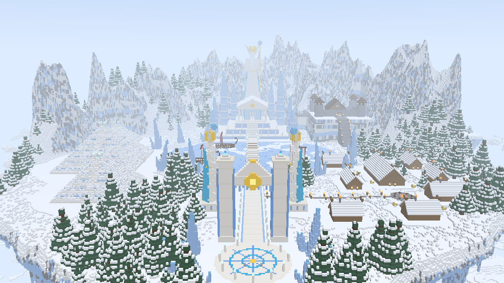 | 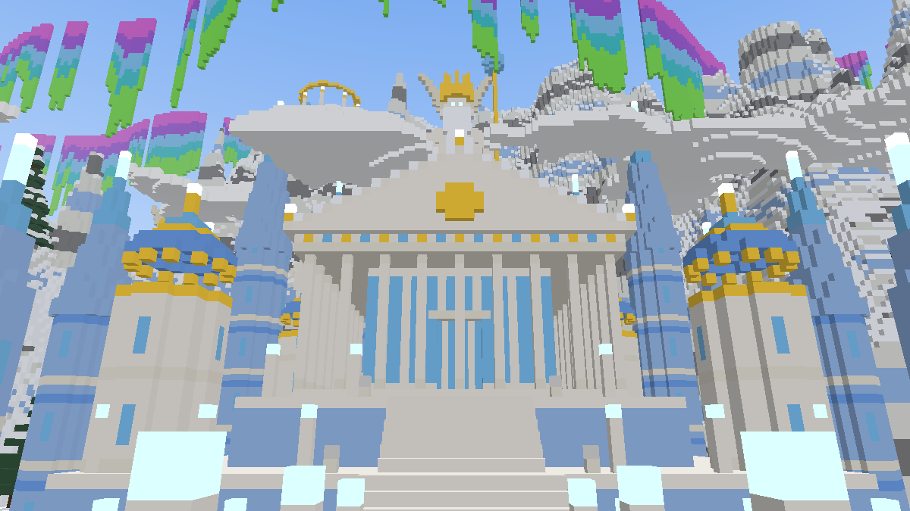 |
| 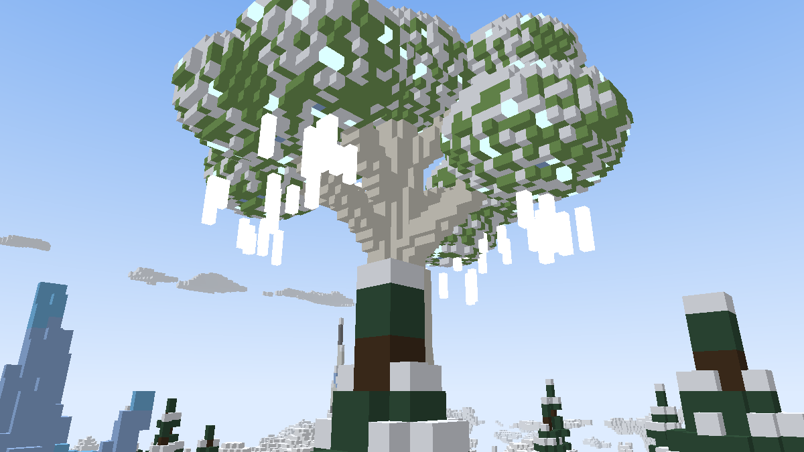 | 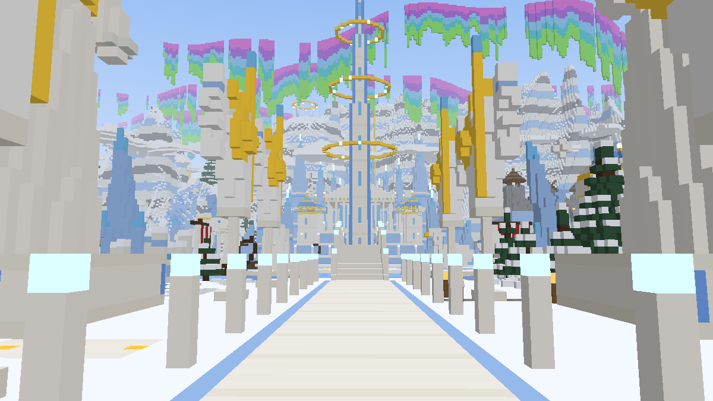 |
| 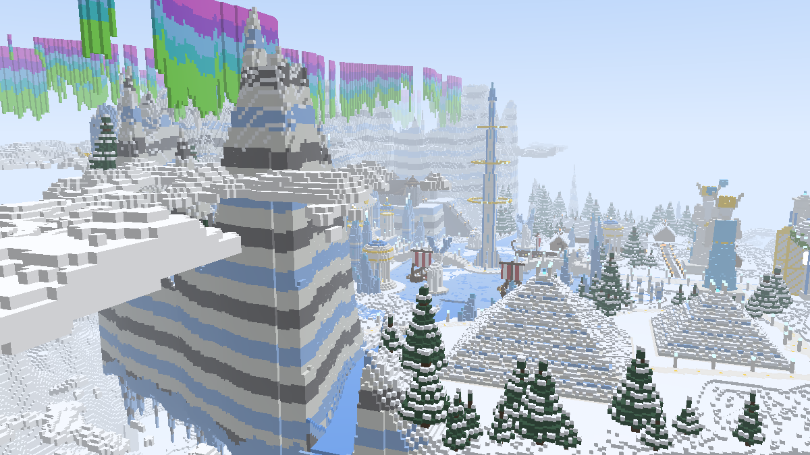 | 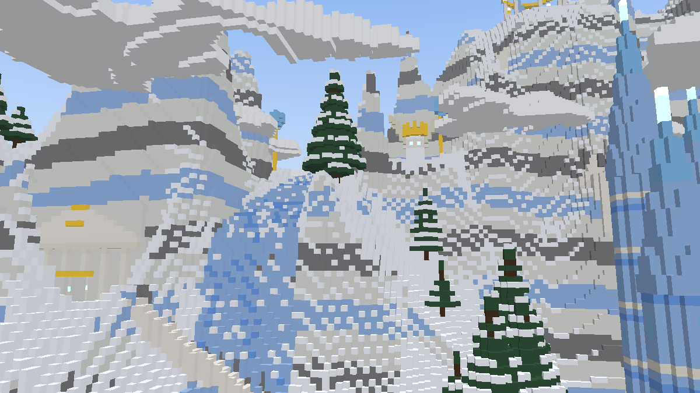 |

*(Previews come from `tools/preview.mjs`, a simple voxel renderer of the exact blueprint, not in-game screenshots. Particles such as the aurora aren't shown.)*

**Everything in Agartha can be broken**, including the clouds and the portal blocks (the exit mends itself). Loot: hoards in the vault, temple, rock-cut halls and pyramid chamber (gold, diamonds, enchanted books, the rare **Jarl's Frostbite Axe**). Longhouses hold food and **Horns of Honey Mead**.

## Hell: the Anti-Hyperborea beneath
Where Agartha is light, ice and ascent above the clouds, Hell is the floor of the world: dark, deep and **directly beneath Agartha**, carved out of a sealed shell of deepslate between Y -63 and Y 34. It draws on the Christian hell (Dante's warning over the gate, the frozen lake of the lowest circle, the mouth of Hell from old paintings) and the Egyptian **Duat** (the twelve Hours of the night, the weighing of the heart against the Feather of Ma'at, Ammit the Devourer, Apep the serpent of chaos, and the *ren*, the true name that holds power over its bearer).

1. **Forge it** (in person, like Agartha): `/scriptevent agartha:forge_hell`. You're carried through the deep while it's carved, then returned and given the **Heart Scarab of the Duat**.
2. **Open the Hellmouth**: use the Heart Scarab on the ground. A weeping, horned beast's head of blackstone rises, its jaws held open around the portal. It's the one way down. If it's sealed (every portal block broken), the Scarab returns.
3. **Walk into its jaws.** Every soul arrives at the very bottom of the pit.

Hell is about three times larger than Agartha's first underworld: a pit, a city, and a cavern, one after another. Its creatures are custom ones, so they hunt you **on any difficulty, even Peaceful**.

### Layer I: the Oubliette of Entropic Recurrence
A pit 80 blocks deep and 31 across, of blackstone and deepslate, with weeping walls, caged gibbets on chains, bone and soul fire on the floor, and an obelisk on a heart of magma that warns *Abandon all hope, ye who enter here*. A slab spiral of **320 steps** climbs the wall for nearly four turns past the **twelve Gates of the Hours**. Each Gate is an alcove with a pylon frame, an inscription and a button.

- **The lava rises.** A few seconds after you arrive the floor begins to burn, and the lava climbs the shaft steadily. **The button at any Gate flushes it** back to the floor, but the noise wakes the damned: a wave comes for you.
- **Spike traps** (24) burst from some steps. Each covers only *some* of the path's three lanes and never the same ones twice, so the darker steps warn you and there is always a way past. They're lethal.
- **Arrow slits** in the walls shoot at whoever climbs past.
- **Vents of soul fire** breathe in a rhythm: a hiss, then a column of flame. Time your crossing.
- **Crumbling steps** give way under anyone who lingers, and grow back later. Some steps are simply missing: jump.
- **The souls are not your friends.** Sixteen translucent, hollow-eyed souls crawl up the spiral beside you. Get too close and one **seizes you and tries to throw you off the stair** into the void, then falls away wailing. They whisper, too.
- **Waves of the damned**: the **Damned** (charred walkers that claw and slow you) and **hellhounds** (fast; they leap, and their bite sets you alight), with champions higher up. In the upper Hours, **Furies** come down out of the dark.
- **Dying anywhere in Hell sends you back to the very bottom** ("AGAIN, ascent N"). Hell remembers how many times you've climbed, how you died ("You remember the burning.") and where ("You died here."). You can't dig or build your way out: nothing breaks except cracked bricks, and nothing you place stays.
- **The hidden way:** halfway up, stepping stones hang over the void. Climb them back the way you came, leap to a ledge in the east wall, and break through the cracked bricks. A dark tunnel with lava to jump runs straight into the City of Dis, past its outer wall.

### Layer II: the City of Dis
At the top, the Twelfth Gate opens on **the Road of Ashes**, lined with bones, down to the west gate of **Dis**: Dante's burning city, behind red-hot iron walls with twelve towers, in a cavern 160 blocks across. The river of fire, the **Phlegethon**, winds through it.

- **The Field of Tombs**: the burning graves of the heretics, lids thrown aside, among ruins and the half-buried crowned head of **a fallen king**.
- **Three Seals bind the inner Gate of Dis.** Stand at a Seal's altar and hold your ground for six seconds to break it, while its guardians come for you:
  - **The Seal of Ash**, in the Mausoleum among the tombs. The tombs burst open.
  - **The Seal of Wind**, atop the **Tower of the Furies**. The Furies come home.
  - **The Seal of Teeth**, in the den of **Garm**, the giant hound of Hel, in the Kennel across the river. Garm wakes, and the pack with him.
  Each broken Seal shatters a lock on the Gate. Break all three and the Gate opens.
- **The Bridge of Sighs** crumbles into the river behind whoever runs across it (it rises again later). **The Bridge of Teeth** is lined with skulls.
- The Damned and the hounds roam the streets; **Furies** circle overhead, shriek, and dive through walls at you (kill them as they come). The river spits geysers of fire. Now and then **dread** falls on the city: darkness, and something comes from behind. And sometimes, far off, **the Watcher** stands and looks at you. Stare too long, or come too near, and it is gone.
- The Seals stay broken while anyone is in Hell. When everyone has left, they mend and the Gate shuts.

### Layer III: the Spire of Absolute Contract
Beyond the Gate, **the Throat**, a square shaft, spirals down to a tunnel and the shore of a vast silent cavern. Here lies **Cocytus**, a frozen lake of black ice where the damned are frozen with only their skulls showing, and the coils of **Apep** arch out of the ice. In its centre stands **the Spire**: brutalist matte-black walls, tinted-glass windows, cold soul light. Enter at its base and climb the stair inside.

- **The Hall of Thrones**: forty-two empty thrones of the judges of the dead in two tiers, braziers of soul fire, the **Scale of Two Truths** (heart against feather) with **Ammit** crouched beside it, and the Devil's horned throne under a rose window. Walk up to the scale and **your heart is weighed**: light if you died no more than twice on the way, heavy otherwise.
- **The Inverse Cathedral** hangs upside down from the roof of the cavern, its spire pointing down at the ice.
- **The Clocktower of Reversion**: its hands turn **backwards**, ticking across the lake.
- Silence: almost no sound but the clock, a low breath, and Agartha's heavenly choir played backwards an octave down. Nothing hunts you here.

### The Devil, Keeper of the Contract
He doesn't fight. **Talk to him** and he remembers how many times you climbed and how your heart weighed. Ask who he is and what this place is. The only way out is a **Deal**:

| Price | What happens |
|---|---|
| **Memory** | You lose every level of experience, and forget everything you learned in Hell. |
| **Possession** | He takes whatever you hold in your hand. |
| **Years** | You're released carrying his mark: weakness, slowness and hunger for ten minutes. |
| **The Feather's Mercy** | Only if your heart was weighed light, and only once ever: go free. |
| **The Wager** | Back to the bottom. Climb to him again **without dying once** and you go free for nothing. Die, and the wager is lost. |
| **Refuse** | Climb again. |
| **His true name** | Five glyphs hidden in Hell each teach one syllable of his name: on the pit floor, at a Gate, in the hidden tunnel, on the lake, in the clocktower. Speak the whole name and he must let you go, and gives back a life he took (a Totem of Undying). Speak the wrong one and the floor opens. |

You're released back to where you entered the Hellmouth.

| | |
|---|---|
| | |
|---|---|
| 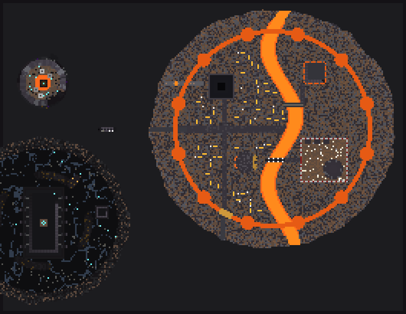 | 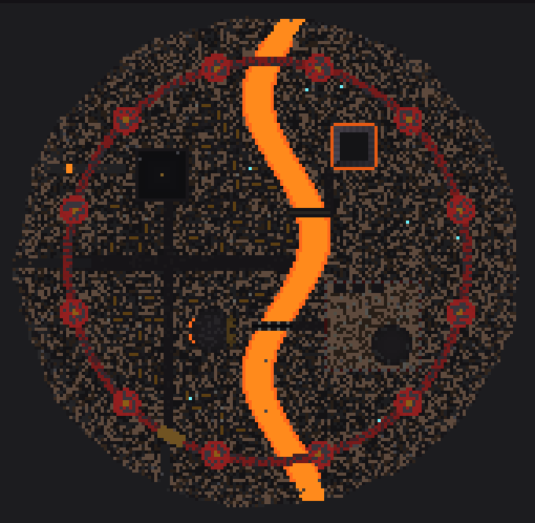 |
| 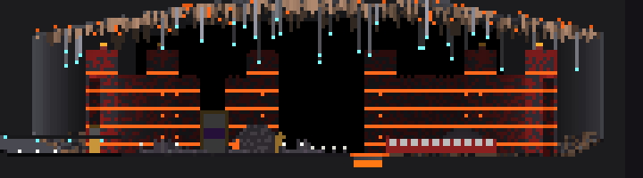 | 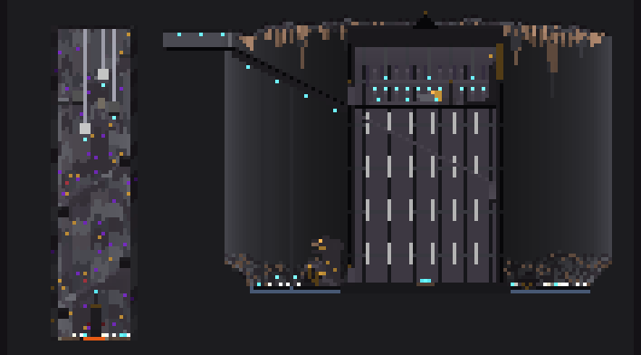 |

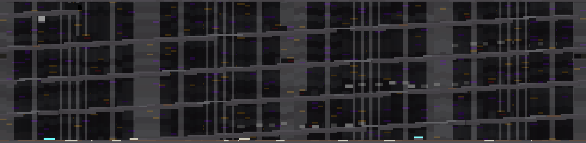

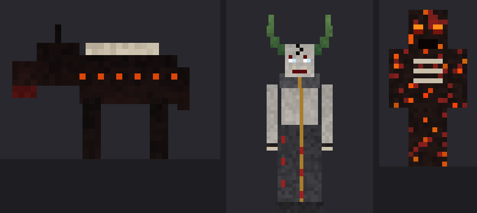

*(Cutaway previews from `tools/preview_hell.mjs`, not in-game screenshots.)*

**Changing the Devil's skin:** replace `resource_pack/textures/entity/devil.png` (128×128, laid out for his model; `tools/gen_hell_assets.py` makes the default).

## Operator commands
| Command | Effect |
|---|---|
| `/scriptevent agartha:forge` | Forge Agartha in person (or finish an interrupted forge). |
| `/scriptevent agartha:rebuild` | Wipe and forge again in one go, e.g. after installing an update (everyone must leave Agartha first). |
| `/scriptevent agartha:erase` | **Delete Agartha**: removes everything the forge built (island, clouds, All-Father, animals), carrying you over the site like forging does. Whatever stood above Y 96 there before the first forge doesn't come back. The Heavenly Gate in your world is left alone; break it by hand. |
| `/scriptevent agartha:keystone` | Get the Keystone again (only when no Gate stands). |
| `/scriptevent agartha:music_length <seconds>` | For your own music: replace `resource_pack/sounds/agartha/ambience.ogg` with your track (OGG Vorbis, same name), then set its length so it loops on time, e.g. `/scriptevent agartha:music_length 60:00` for one hour (minutes:seconds or plain seconds). `0` goes back to the built-in 2-minute choir. Saved in the world. |
| `/scriptevent agartha:gate_reset` | Forget the Gate's location, e.g. if it was destroyed by other means. |
| `/scriptevent agartha:fx_test` | Plays Agartha's chime and arrival choir, and shows snow, lights, god rays, aurora and mist right where you stand (works anywhere) to check sound and effects are working. |
| `/scriptevent agartha:status` | Check that everything works: whether Agartha and Hell are forged, where the Gate and the Hellmouth are, how many of their portal blocks are present, and whether the portal block is loaded. |
| `/scriptevent agartha:forge_hell` | Forge Hell in person (or finish an interrupted forge). |
| `/scriptevent agartha:rebuild_hell` | Carve Hell again from scratch (everyone must leave Hell first). |
| `/scriptevent agartha:erase_hell` | **Delete Hell**: fills its place with solid rock (deepslate below Y 0, stone above). The Hellmouth in your world is left alone. |
| `/scriptevent agartha:scarab` | Get the Heart Scarab again (only when no Hellmouth stands). |
| `/scriptevent agartha:hellmouth_reset` | Forget the Hellmouth's location. |
| `/scriptevent agartha:hell_release` | Release yourself from Hell (for operators). |

## Safety
Bedrock add-ons **can't create real dimensions**, so Agartha is a sealed pocket of the Overworld sky centred on X 99,890 / Z 100,298. **Every block the forge writes is bounds-checked** against one reserved box (X 99,536 → 100,239, Z 99,936 → 100,639, Y 96 → 319), and world generation is never changed. `tools/test_blueprint.mjs` verifies all ~820,000 build operations stay inside. Hell is carved inside a second reserved box deep beneath it (X 99,856 → 100,175, Z 100,192 → 100,447, Y -63 → 34), from a sealed shell of deepslate: everything natural inside that shell (stone, ores, caves) is replaced, and nothing outside it is touched. The only things built outside the two boxes are the Heavenly Gate and the Hellmouth, where *you* choose to raise them.

Requires Bedrock **1.21.90+**. No experimental toggles are needed.

## Install & updates
Run `./tools/package.sh` and open **`dist/Agartha_v<version>.mcaddon`** (currently `Agartha_v2.1.0.mcaddon`), then activate **both** packs on your world. In Minecraft they show as **Agartha v2.1.0 (Behavior)** and **Agartha v2.1.0 (Resources)**.

Every update gets a new version number (in `VERSION`) stamped into the file name, the pack names, and the pack versions. Importing a newer `.mcaddon` replaces the older packs instead of being refused as a duplicate. For a new release, bump `VERSION` and run `./tools/package.sh`.

In the creative inventory, all Agartha items (Keystone, Heavenly Gate portal block, Jarl's Axe, Mead Horn, Agartha Cloud, Heart Scarab, Hellmouth portal block) sit together in one collapsible **Agartha** group under *Items*.

## Development
| Command | Purpose |
|---|---|
| `node tools/test_blueprint.mjs` | Bounds, tile and terrain checks for the whole build. |
| `node tools/smoke_test.mjs` | Runs the scripts against a mock Minecraft API: forging in person, the Keystone, the Gate, both portals, the All-Father, exit mending, falling, the Keystone returning. |
| `node --max-old-space-size=6000 tools/preview.mjs && python3 tools/ppm2png.py` | Renders preview images into `dist/preview/`. |
| `python3 tools/gen_textures.py` | Regenerates textures, including the default All-Father skin. |
| `python3 tools/gen_sounds.py` | Re-synthesizes the soundscape (needs numpy and ffmpeg). |
| `python3 tools/gen_choir.py` | Re-synthesizes the two-minute choir loop (needs numpy and ffmpeg). |
| `node tools/smoke_hell.mjs` | Walks a soul through Hell against the mock API: forging, the Hellmouth, lava, spikes, arrow slits, fire vents, grasping souls, crumbling steps, buttons, waves, glyphs, death and recurrence; the City of Dis (its hunters, a Fury's dive, all three Seals and their guardians, the Gate opening, the Bridge of Sighs falling); the weighing, the clock, and every Deal. |
| `node tools/test_hell.mjs` | Checks every Hell operation stays inside its box, and that every walkway (the spiral, the roads, the bridges, every stair) has room to stand. |
| `node tools/preview_hell.mjs && python3 tools/ppm2png.py` | Renders cutaway sections and plans of Hell into `dist/preview/`. |
| `python3 tools/gen_hell_assets.py` | Regenerates the Devil's model and skin (also worn by the Furies and the Watcher), the hellhound's model, the skins of the souls and the Damned, the Hellmouth portal and the Scarab icon. |
| `cd tools && python3 gen_hell_sounds.py` | Re-synthesizes Hell's sounds (needs numpy and ffmpeg). |

The layout lives in `behavior_pack/scripts/terrain.js` (`LAYOUT`), the landmarks in `structures.js` and `citadel.js`, and location and heights in `config.js`. Bump `buildVersion` to rebuild existing worlds after changes. Hell's geometry is in `hell_layout.js` (shared by the blueprint and the runtime), its blocks in `hell_blueprint.js`, its gameplay in `hell.js` (the pit, the loop, the Spire), `hell_dis.js` (the City of Dis) and `hell_creatures.js` (the Damned, hellhounds, Furies, the Watcher), its sound and air in `hell_ambience.js`, and the Devil's dialogue in `devil.js`.
